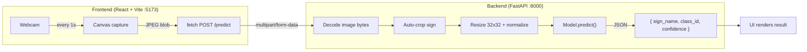
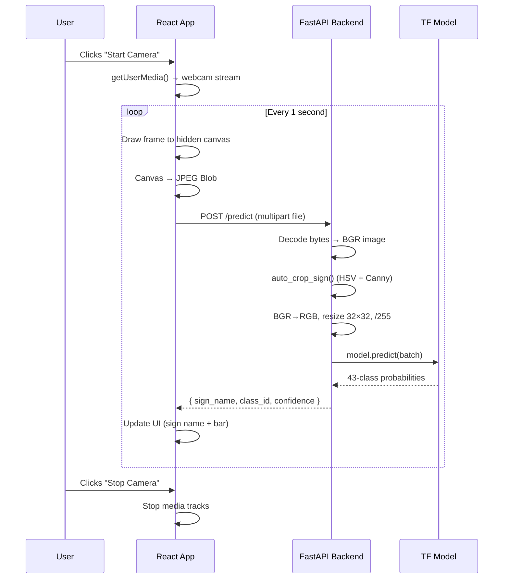

# Traffic Sign Detection — Complete Codebase Walkthrough

## Project Overview

This is a **full-stack, real-time traffic sign detection web application** built as a mini-project. It uses a CNN model trained on the **GTSRB** (German Traffic Sign Recognition Benchmark) dataset to classify **43 types** of traffic signs from a live webcam feed.

| Layer | Technology |
|-------|-----------|
| **ML Model** | TensorFlow/Keras CNN (`.h5` format) |
| **Backend** | Python — FastAPI + Uvicorn |
| **Frontend** | React 19 + Vite 8 |
| **Preprocessing** | OpenCV (auto-crop, resize, normalize) |
| **Styling** | Vanilla CSS with custom design tokens |

---

## Architecture Diagram



---

## Directory Structure

```
Dspl_Miniproject/
├── backend/
│   ├── main.py                  # FastAPI server (prediction endpoint)
│   └── requirements.txt         # Backend Python deps
├── frontend/
│   ├── index.html               # HTML shell (Inter font, meta tags)
│   ├── vite.config.js           # Vite dev server config
│   ├── package.json             # React 19, Vite 8
│   ├── public/
│   │   ├── favicon.svg
│   │   └── icons.svg
│   └── src/
│       ├── main.jsx             # React entry point (StrictMode)
│       ├── App.jsx              # Sole component — camera + results UI
│       ├── App.css              # Component styles (488 lines)
│       └── index.css            # Global reset + design tokens
├── labels.py                    # GTSRB 43-class label map (shared)
├── test_image.py                # CLI tool to test model on a single image
├── traffic_sign_model.h5        # Pre-trained CNN model (~16 MB)
├── requirements.txt             # Root-level Python deps (training)
├── cmds                         # Quick-reference run commands
├── .gitignore
└── README.md
```

---

## Detailed File Breakdown

### 1. Shared / Root Files

---

#### [labels.py](file:///c:/Users/Rishabh/Music/Dspl_Mp/Dspl_Miniproject/labels.py)

A single `SIGN_NAMES` dictionary mapping class IDs `0–42` to human-readable names (e.g., `0 → "Speed Limit 20 km/h"`, `14 → "Stop"`, `38 → "Keep Right"`). Imported by both the backend and the CLI test script.

```python
SIGN_NAMES = {
    0: "Speed Limit 20 km/h",
    ...
    42: "End of No Passing by Vehicles over 3.5 tons",
}
NUM_CLASSES = len(SIGN_NAMES)  # 43
```

---

#### [traffic_sign_model.h5](file:///c:/Users/Rishabh/Music/Dspl_Mp/Dspl_Miniproject/traffic_sign_model.h5)

The pre-trained Keras model file (~16 MB). It expects **32×32×3 RGB** images normalized to `[0, 1]` and outputs a 43-class softmax probability vector. The architecture is a multi-block CNN (Conv2D layers with MaxPooling, Dropout, Dense).

---

#### [test_image.py](file:///c:/Users/Rishabh/Music/Dspl_Mp/Dspl_Miniproject/test_image.py) — CLI Testing Script

A standalone script to test the model on a single image file:

```
python test_image.py path/to/image.jpg
```

**Key logic:**

| Step | What it does |
|------|-------------|
| `auto_crop_sign()` | Uses HSV saturation thresholding + Canny edge detection to find the sign region. Falls back to center-crop if detection fails. |
| `crop_center_square()` | Crops the largest centered square — makes Google images look like GTSRB training data. |
| `predict()` | BGR→RGB conversion, resize to 32×32, normalize `/255`, model inference, argmax for class ID. |

> [!IMPORTANT]
> The model was trained on **RGB** images (PIL/HuggingFace pipeline), but OpenCV loads as **BGR**. Both `test_image.py` and `backend/main.py` explicitly convert `BGR → RGB` before inference.

---

### 2. Backend — FastAPI Server

---

#### [backend/main.py](file:///c:/Users/Rishabh/Music/Dspl_Mp/Dspl_Miniproject/backend/main.py)

A single-file FastAPI application with two endpoints:

| Endpoint | Method | Purpose |
|----------|--------|---------|
| `/predict` | `POST` | Accepts a `multipart/form-data` image, returns `{ class_id, sign_name, confidence }` |
| `/health` | `GET` | Returns `{ status: "ok", model_loaded: true/false }` |

**Startup flow:**
1. `@app.on_event("startup")` loads `traffic_sign_model.h5` into memory once.
2. CORS is configured to allow all origins (`*`) for local dev.

**Prediction pipeline (mirrors `test_image.py`):**
```
Raw bytes → cv2.imdecode (BGR) → auto_crop_sign() → BGR→RGB → resize 32×32 → /255.0 → model.predict()
```

The `auto_crop_sign()` function is **duplicated** from `test_image.py` (same logic — HSV saturation + Canny edges + contour detection + fallback center crop).

**Run command:**
```bash
uvicorn main:app --reload --host 0.0.0.0 --port 8000
```

#### [backend/requirements.txt](file:///c:/Users/Rishabh/Music/Dspl_Mp/Dspl_Miniproject/backend/requirements.txt)

```
fastapi>=0.100.0, uvicorn, python-multipart, tensorflow>=2.10.0, opencv-python>=4.7.0, numpy>=1.23.0
```

---

### 3. Frontend — React + Vite

---

#### [frontend/index.html](file:///c:/Users/Rishabh/Music/Dspl_Mp/Dspl_Miniproject/frontend/index.html)

- Loads **Inter** font from Google Fonts (weights 400–800)
- SEO meta description for traffic sign detection
- Mounts React app at `<div id="root">`

---

#### [frontend/vite.config.js](file:///c:/Users/Rishabh/Music/Dspl_Mp/Dspl_Miniproject/frontend/vite.config.js)

- Uses `@vitejs/plugin-react`
- Dev server bound to `0.0.0.0:5173`
- Allowed host: `traffic.rishabhkanojiya.in` (custom domain for deployment)

---

#### [frontend/src/main.jsx](file:///c:/Users/Rishabh/Music/Dspl_Mp/Dspl_Miniproject/frontend/src/main.jsx)

Standard React 19 entry — renders `<App />` inside `<StrictMode>`.

---

#### [frontend/src/App.jsx](file:///c:/Users/Rishabh/Music/Dspl_Mp/Dspl_Miniproject/frontend/src/App.jsx) — The Core Component

This is the **entire frontend in a single component** (~295 lines). Here's the breakdown:

**State:**

| Variable | Type | Purpose |
|----------|------|---------|
| `cameraOn` | boolean | Whether webcam stream is active |
| `loading` | boolean | API request in-flight |
| `result` | object \| null | `{ sign_name, class_id, confidence }` from backend |
| `snapshot` | string \| null | Base64 data URL of the last captured frame |
| `error` | string \| null | Error message to display |
| `latency` | number | Round-trip prediction time in ms |

**Refs:** `videoRef` (video element), `canvasRef` (offscreen canvas), `streamRef` (MediaStream), `isProcessingRef` (debounce guard).

**Key functions:**

| Function | What it does |
|----------|-------------|
| `startCamera()` | Requests `getUserMedia` with `facingMode: "environment"`, stores stream |
| `stopCamera()` | Stops all tracks, clears video source |
| `captureAndPredict()` | Draws current video frame to canvas → converts to JPEG blob → POSTs to `localhost:8000/predict` → updates state with result |
| `getConfidenceLevel()` | Returns `"high"` (≥80%), `"medium"` (≥50%), or `"low"` for color-coding the confidence bar |

**Auto-capture loop:** When `cameraOn` is true, a `setInterval` fires `captureAndPredict()` every **1 second**.

**UI sections:**
1. **Animated background** — Floating SVG shapes (triangle, circle, octagon, diamond) + moving road dashes
2. **Header** — App title with scan icon (status badge is commented out)
3. **Camera panel** — Live video feed + start/stop button
4. **Result panel** — Shows detected sign name + animated confidence bar (green/yellow/red)

---

#### [frontend/src/index.css](file:///c:/Users/Rishabh/Music/Dspl_Mp/Dspl_Miniproject/frontend/src/index.css) — Design System

Defines CSS custom properties (design tokens):

| Token | Value | Purpose |
|-------|-------|---------|
| `--bg` | `#f8fafc` | Page background (light slate) |
| `--surface` | `#ffffff` | Card/panel background |
| `--accent` | `#2563eb` | Primary blue |
| `--success` | `#059669` | High-confidence green |
| `--warning` | `#d97706` | Medium-confidence amber |
| `--radius-lg` | `12px` | Card border radius |
| `--ease` | `cubic-bezier(0.4, 0, 0.2, 1)` | Smooth transition curve |

Also includes a global reset and sets Inter as the primary font.

---

#### [frontend/src/App.css](file:///c:/Users/Rishabh/Music/Dspl_Mp/Dspl_Miniproject/frontend/src/App.css) — Component Styles (488 lines)

Key visual features:

| Feature | Implementation |
|---------|---------------|
| **Floating shapes** | `@keyframes float` — translate + rotate loop over 20–28s |
| **Moving road** | Repeating linear gradient with `@keyframes move-road` |
| **Pulsing live dot** | `@keyframes pulse-dot` — opacity oscillation |
| **Result fade-in** | `@keyframes fade-in` — translateY + opacity |
| **Confidence bar** | Color changes by class: `.high` (green), `.medium` (amber), `.low` (red) |
| **Responsive** | `@media (max-width: 768px)` — stacks panels vertically |

---

## Data Flow (End-to-End)



---

## Key Design Decisions

| Decision | Rationale |
|----------|-----------|
| **Auto-crop before inference** | GTSRB training images are tightly cropped signs. Real webcam/Google images have backgrounds that confuse the model. HSV saturation + edge detection isolates the sign. |
| **BGR → RGB conversion** | OpenCV loads BGR by default, but the model was trained on RGB (PIL). Omitting this caused wrong predictions (documented fix from earlier work). |
| **1-second capture interval** | Balances real-time feel with API load. `isProcessingRef` prevents overlapping requests. |
| **Single-component frontend** | Keeps the app simple for a mini-project. No routing, no state management library needed. |
| **CORS allow all** | Development convenience — intended for local or known-host deployment. |

---

## How to Run

```bash
# Terminal 1 — Backend
cd backend
pip install -r requirements.txt
uvicorn main:app --reload --host 0.0.0.0 --port 8000

# Terminal 2 — Frontend
cd frontend
npm install
npm run dev
```

Then open `http://localhost:5173`, allow camera access, and point at a traffic sign.

---

## Observations & Notes

> [!NOTE]
> The `auto_crop_sign()` and `crop_center_square()` functions are **duplicated** between `test_image.py` and `backend/main.py`. They could be refactored into a shared `preprocessing.py` module.

> [!NOTE]
> The `latency` state is computed but **never rendered** in the UI. It's tracked internally but not displayed anywhere.

> [!NOTE]
> The `snapshot` state (captured frame data URL) is stored but also **never rendered** — the snapshot preview is not wired up in the current JSX.

> [!NOTE]
> The header's status badge + "GTSRB Model" metadata section is **commented out** in `App.jsx` (lines 174–181).
